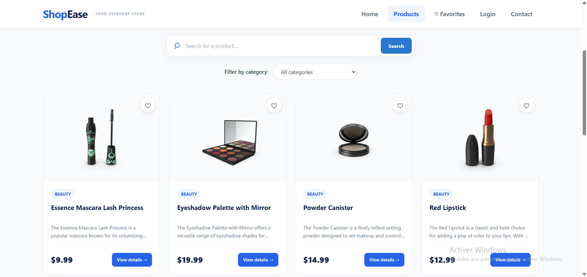
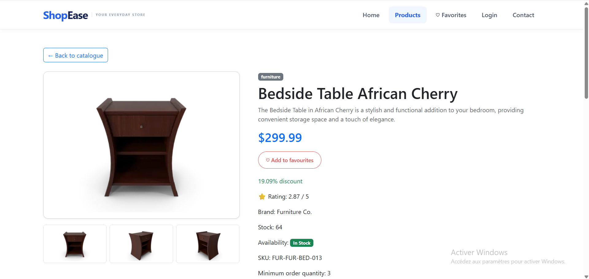
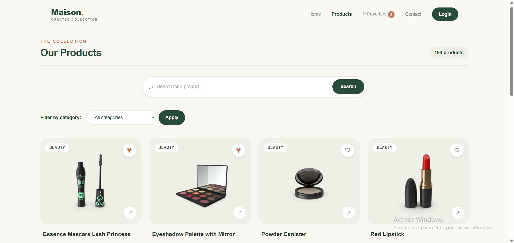
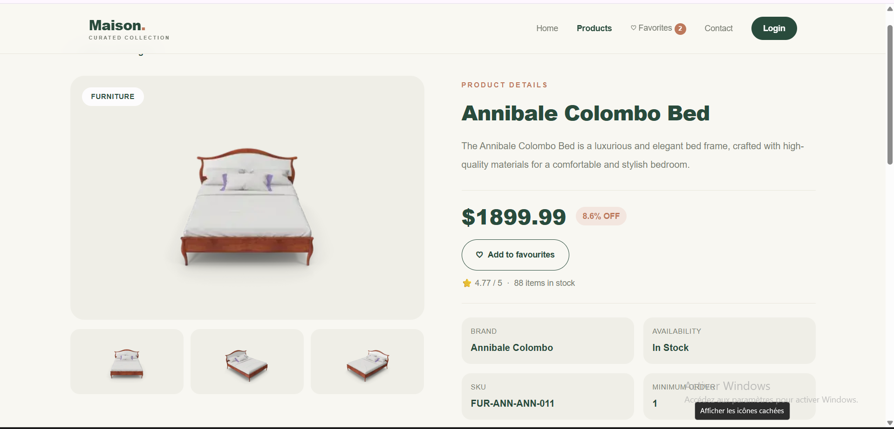

# 🛍️ Fullstack Catalogue

<div align="center">

# Two Applications. One Catalogue Experience.

A comparison of two modern product catalogue applications built with **Angular** and **Next.js**, containerized with Docker and served in production environments.

[Angular Application](#-angular-application) · [Next.js Application](#-nextjs-application) · [Docker](#-docker-deployment)


</div>

---

## ✨ About the Project

This project brings together two independent implementations of a modern product catalogue. Both applications consume the [DummyJSON API](https://dummyjson.com/products) to display product information.

The objective is to develop, containerize, test, and publish both applications using Docker.

## 🚀 Applications

<table>
<tr>
<td width="50%" valign="top">

<h3 align="center">🔵 ShopEase — Angular</h3>

<p align="center">
A responsive product catalogue built with Angular and Bootstrap 5.
</p>

**Highlights**
- Product catalogue
- Product details
- Search and category filtering
- Favorites management
- Responsive interface
- Nginx production server

<p align="center">
<a href="ngapp/"><strong>Explore Angular source →</strong></a>
</p>

</td>
<td width="50%" valign="top">

<h3 align="center">🟢 Maison — Next.js</h3>

<p align="center">
A modern product catalogue built with Next.js and React.
</p>

**Highlights**
- Product catalogue
- Product details
- Search and category filtering
- Favorites management
- Responsive interface
- Next.js standalone production server

<p align="center">
<a href="nxapp/"><strong>Explore Next.js source →</strong></a>
</p>

</td>
</tr>
</table>

## 📸 Application Preview

### Angular — ShopEase

| Product Catalogue | Product Details |
|:---:|:---:|
|  |  |

### Next.js — Maison

| Product Catalogue | Product Details |
|:---:|:---:|
|  |  |

## 🛠️ Technologies

| Category | Technologies |
|---|---|
| Angular frontend | Angular, TypeScript, Bootstrap 5 |
| Next.js frontend | Next.js, React, TypeScript |
| API | DummyJSON |
| Angular production server | Nginx |
| Containerization | Docker |
| Version control | Git and GitHub |

## 🐳 Docker Deployment

Both applications use multi-stage Docker builds to create production images.

### Angular Application

**Build the image**

```bash
docker build -t ngapp:1.0 ./ngapp
```

**Run the container**

```bash
docker run -d --name ngapp-container -p 8080:80 ngapp:1.0
```

Open: http://localhost:8080

### Next.js Application

**Build the image**

```bash
docker build -t nxapp:1.0 ./nxapp
```

**Run the container**

```bash
docker run -d --name nxapp-container -p 3000:3000 nxapp:1.0
```

Open: http://localhost:3000

### Docker Hub Images

| Application | Docker Hub Repository | Image |
|---|---|---|
| Angular | [View on Docker Hub](https://hub.docker.com/repository/docker/didenala/ngapp/general) | `didenala/ngapp:1.0` |
| Next.js | [View on Docker Hub](https://hub.docker.com/repository/docker/didenala/nxapp/general) | `didenala/nxapp:1.0` |


## 💻 Run Locally

**Angular**

```bash
cd ngapp
npm install
npm start
```

**Next.js**

```bash
cd nxapp
npm install
npm run dev
```

## 📁 Repository Structure

```text
fullstack-tp/
│
├── ngapp/
│   ├── Dockerfile
│   ├── nginx.conf
│   ├── .dockerignore
│   └── src/
│
├── nxapp/
│   ├── Dockerfile
│   ├── .dockerignore
│   ├── next.config.ts
│   └── app/
│
├── screenshots/
│
├── .gitignore
└── README.md
```

## 👩‍💻 Project Goals

- Develop two product catalogue applications using different frontend frameworks.
- Configure production-ready Docker images using multi-stage builds.
- Test the applications locally and inside containers.
- Publish the images to Docker Hub.
- Organize and document the source code using Git and GitHub.

---

<div align="center">

**Fullstack Catalogue Project**

Built with ❤️ using Angular, Next.js and Docker.

</div>